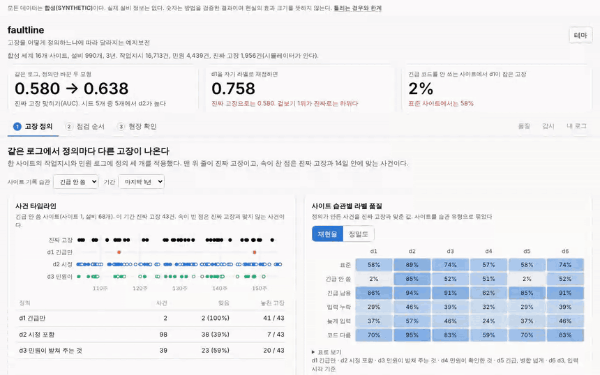
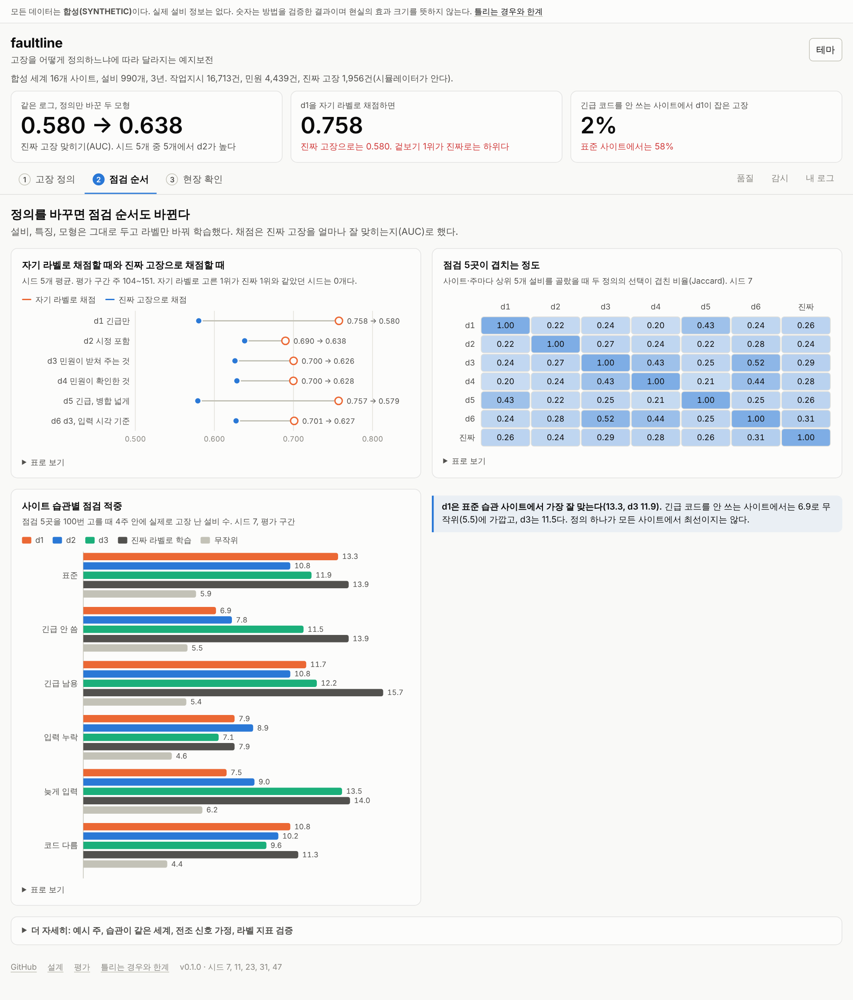

# faultline

고장을 어떻게 정의하느냐에 따라 달라지는 예지보전 모형을, 정답을 아는 합성 로그에서 재는 분석 서비스.

작업지시 로그에는 고장이라는 열이 없다. 어떤 작업지시를 고장으로 칠지는 사람이 정하고, 그 정의로 만든 라벨이 모형이 배우는 정답이 된다. 사이트마다 작업지시를 입력하는 습관이 다르면(긴급 코드를 거의 안 쓰는 곳, 유형 코드가 A1·B2인 곳 등) 같은 정의가 사이트마다 다른 뜻이 된다. 이 프로젝트는 정의를 YAML 파일로 쓰고, 정의마다 라벨과 모형이 진짜 고장과 얼마나 맞는지 재고, 현장 확인 몇 건으로 정의를 검증하고, 기록 습관이 바뀌는 것을 로그만으로 감시한다.

## 데모

<https://sokldjs554.github.io/faultline/> (서버 없이 열리는 정적 데모)



모든 데이터는 합성(SYNTHETIC)이다. 시뮬레이터가 진짜 고장을 알고 있어서, 아래 숫자는 정의와 검증 방법이 정답을 얼마나 맞히는지 확인한 결과다. 현실의 성능은 아니다.

## 결과 요약

- 같은 설비, 같은 특징, 같은 모형에 라벨 정의만 바꿔 학습하면 진짜 고장을 맞히는 정도(AUC)가 d1(긴급 작업지시만 고장) <!-- num:summary.auc.d1|.3f -->0.580<!-- /num -->, d2(예방이 아닌 작업지시 전부) <!-- num:summary.auc.d2|.3f -->0.638<!-- /num -->. 시드 <!-- num:summary.worlds.base_seeds|d -->5<!-- /num -->개 중 <!-- num:summary.auc.d2_beats_d1_seeds|d -->5<!-- /num -->개에서 d2가 높음
- d1을 자기 라벨로 채점하면 AUC <!-- num:summary.apparent.d1_own_auc|.3f -->0.758<!-- /num -->로 가장 좋아 보이고, 진짜 고장으로는 <!-- num:summary.apparent.d1_truth_auc|.3f -->0.580<!-- /num -->이다. 자기 라벨의 1위가 진짜 1위인 시드는 <!-- num:summary.apparent.best_by_own_is_best_by_truth|d -->0<!-- /num -->개
- 긴급 코드를 거의 안 쓰는 사이트에서 d1이 잡은 진짜 고장은 <!-- num:summary.labels.d1_recall_no_emergency_sites|.0% -->2%<!-- /num -->, 표준 사이트에서는 <!-- num:summary.labels.d1_recall_standard_sites|.0% -->58%<!-- /num -->
- 사이트 습관이 모두 같은 대조 세계에서는 정의 사이의 AUC 차이(최대−최소)가 <!-- num:summary.auc.spread_uniform|.3f -->0.025<!-- /num -->로, 습관이 다른 세계의 <!-- num:summary.auc.spread|.3f -->0.061<!-- /num -->보다 작음



## 틀리는 경우

- 현장 확인으로 사이트마다 정의를 골라도 전 사이트에 d2를 쓴 것보다 낫지 않다. 확인 80건으로 고른 모형의 AUC는 <!-- num:summary.customization.audit_80|.3f -->0.632<!-- /num -->, 전 사이트 d2는 <!-- num:summary.customization.fixed_d2|.3f -->0.638<!-- /num -->
- 현장 확인 320건으로도 최선의 정의를 고르는 비율이 90%에 못 미친다. 다만 고르지 못해서 잃는 점수는 80건에서 <!-- num:summary.audit.regret_80|.3f -->0.022<!-- /num -->, 건수가 늘수록 줄어든다
- 습관이 바뀐 사이트 <!-- num:summary.drift.shifts|d -->20<!-- /num -->곳 중 <!-- num:summary.drift.detected|d -->11<!-- /num -->곳만 로그로 알아챘고, 알아채는 데 중앙값 <!-- num:summary.drift.delay_median_weeks|.0f -->32<!-- /num -->주가 걸렸다. 바뀌지 않은 사이트·실행 <!-- num:summary.drift.quiet_site_runs|d -->140<!-- /num -->건 중 <!-- num:summary.drift.false_alarm_site_runs|d -->3<!-- /num -->건에서 거짓 경보가 났다
- 정의를 고르는 지표로 F1을 쓰면 오히려 모형 성능과 반대로 움직인다(순위 상관 <!-- num:summary.validity.f1|.2f -->-0.39<!-- /num -->). 재현율은 같은 방향(<!-- num:summary.validity.recall|.2f -->0.78<!-- /num -->)이다
- 이 결과는 시뮬레이터의 가정에 기대고 있다. 경계는 [docs/failures.md](docs/failures.md)에 적었다

## 직접 구현한 것

| 구현 | 위치 | 확인 방법 |
|---|---|---|
| 시뮬레이터 (손상, 점검, 고장, 사이트별 입력 습관 6가지, 지저분한 로그) | `sim/` | 불변식 테스트, 같은 시드 재현 |
| 고장 정의 파일(YAML)과 엔진 (작업지시 유형, 민원 근거, 민원 군집, 병합, 사건 시각) | `define/` | 손으로 만든 작은 로그에서 사건 수 테스트 |
| 작업지시 유형 정규화와 품질 점검 | `quality/` | 중복·날짜 역전·빈 설비·코드 미분류·긴급 비중 이상 테스트 |
| 라벨 품질 (사건과 진짜 고장의 일대일 매칭) | `eval/labels.py` | 가까운 쌍 우선 매칭 테스트 |
| 정의별 모형 비교 (HistGradientBoosting, PyTorch MLP) | `models/`, `eval/experiments.py` | 특징 누수 테스트(미래 기록을 잘라도 같은 값) |
| 현장 확인 표본 설계와 추정 (층화 추출, 가중 추정, 부트스트랩 구간) | `eval/experiments.py` | 추정값이 정답의 평균과 맞는지 테스트 |
| 기록 습관 변화 감시 (CUSUM) | `monitor/drift.py` | 계단 변화에 경보, 잡음에 무경보 테스트 |
| API와 콘솔 | `api/`, `console/` | API 테스트, 브라우저 스모크(모든 탭, 다크, 모바일) |

## 실행 방법

```bash
make install     # 개발용 패키지 설치
make test        # 테스트
make serve       # http://localhost:8000/console/  (실험 결과는 artifacts/ 에 들어 있음)
make pipeline    # 실험 전체를 다시 돌림 (4 vCPU 기준 약 10분)
docker compose up --build
```

명령줄에서 쓰는 방법은 아래와 같다.

```bash
faultline definitions                       # 내장 정의 목록
faultline evaluate my_definition.yaml       # 정의를 데모 세계에 적용해 라벨 품질을 잼
faultline quality work_orders.csv           # 작업지시 CSV 품질 점검
```

## 문서

[설계](docs/design.md) · [고장 정의](docs/definitions.md) · [시뮬레이터](docs/simulator.md) · [평가](docs/evaluation.md) · [틀리는 경우와 한계](docs/failures.md) · [실제 로그에 적용하기](docs/real-data.md) · [조사](docs/research.md) · [만든 방식과 AI 사용 공개](docs/how-this-was-built.md)

## 채용 공고와 대응

| 공고 | 저장소 |
|---|---|
| Python 데이터 전처리·분석 (Pandas, NumPy) | `sim/`, `quality/`, `eval/` (유형 코드 정규화, 중복·결측 처리, 시간 분할 라벨) |
| 회귀·분류 | 4주 안 고장 확률(분류), 정의별 라벨 품질(정밀도·재현율) |
| 딥러닝 설계·성능 개선 (PyTorch) | `models/fit.py`의 MLP. 같은 입력과 라벨로 트리 모형과 비교하고 순위가 같게 나옴 |
| 분석 결과를 API/웹으로 (FastAPI) | `api/`(정의 검증·평가, 로그 품질 점검, 결과 조회), `console/` |
| 데이터 시각화 | 타임라인, 히트맵, 추정 구간 차트 (표 보기, 다크 모드) |
| 클라우드 (AWS, GCP) | `Dockerfile`, `deploy/gcp`, `deploy/aws` |
| 실제 서비스 운영 | `/health`, `/metrics`, 업로드 한도, 습관 변화 감시, CI(린트, 테스트, 숫자 일치, 데모 최신 여부, 콘솔 스모크, 이미지 빌드) |
| 실증 프로젝트, 고객 맞춤형 모델 | 고객 로그의 품질 점검, 고객별 정의 선택을 위한 현장 확인 설계 |

## 범위와 한계

- 실제 데이터 없음. 시뮬레이터가 정답을 알아서 정의를 채점할 수 있는 대신, 결과는 시뮬레이터의 가정에 기댐
- 사이트 습관 6가지는 사람이 정한 유형이고, 실제 습관의 분포를 대표하지 않음
- 현장 확인은 설비·주 단위 표본을 정답과 맞추는 절차이며, 실제 현장에서 누가 어떻게 확인할지는 설계만 함
- 콘솔은 인증이 없는 데모
